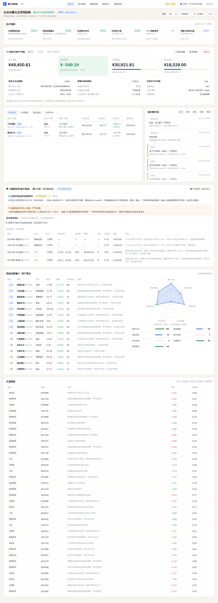

# 量化交易驾驶舱（复刻版）

一个 **LLM 驱动的 A 股短线全自动交易系统**：五源情报 → 两级选股漏斗 → LLM 盘中滚动推演 → 交易意向 → 区间执行 → T+3 强制复评，由硬性风控与双账本对账兜底。



设计拆解见 [docs/ARCHITECTURE.md](docs/ARCHITECTURE.md)。

## 快速开始（离线模拟，不需要任何 Key）

```bash
cd quant_cockpit
pip install -r requirements.txt
QC_SIM_SPEED=120 uvicorn backend.app:app --port 8000
# 打开 http://localhost:8000
```

默认是 `sim` 模式：模拟行情、模拟撮合，Mock LLM（规则引擎，输出格式与真实 LLM 完全一致）。
模拟时钟从当天 09:00 开始，按倍速推进；页面上的「下一交易日」用来测试 T+1 和 T+3 复评。

## 接入真实大模型

```bash
# DeepSeek / 通义千问 / Kimi / OpenAI 等 OpenAI 兼容接口
export QC_LLM_PROVIDER=openai QC_LLM_BASE_URL=https://api.deepseek.com/v1 QC_LLM_MODEL=deepseek-chat QC_LLM_API_KEY=sk-...
# 或者 Anthropic Claude
export QC_LLM_PROVIDER=anthropic QC_LLM_BASE_URL=https://api.anthropic.com QC_LLM_MODEL=claude-sonnet-5-5 QC_LLM_API_KEY=sk-ant-...
export QC_LLM_BUDGET=20   # 每日预算（元），超出后自动降级为规则引擎
```

### DeepSeek 自检

```bash
export QC_LLM_PROVIDER=openai QC_LLM_API_KEY=sk-...    # base_url / model 默认就是 DeepSeek
python -m backend.check_llm
```

自检会依次做三件事：先发一个最小请求，确认网络、密钥和余额都正常；再在临时库里把模拟盘跑到 10:00，由 DeepSeek 完成漏斗分析和几轮盘中推演；最后打印 LLM 原始输出和经代码校验后发布的意向。
`deepseek-reasoner` 也能用（`QC_LLM_MODEL=deepseek-reasoner`），系统会自动去掉它不支持的 JSON 模式和 temperature 参数。不过它更慢，推演间隔建议调到 ≥ 15 分钟，`QC_LLM_TIMEOUT` 也要调大。

## 接入真实行情（纸面交易）

```bash
pip install akshare
QC_MODE=paper QC_MARKET=akshare uvicorn backend.app:app --port 8000
```

## 实盘

`backend/broker.py` 里有 `QmtBroker`（迅投 miniQMT / xtquant）骨架，需要券商开通 QMT 权限，并在 Windows 上运行客户端。
**默认不会启用。** 请先用模拟和纸面交易跑够时间，确认风控参数符合预期后再考虑。

## 主要环境变量

| 变量 | 默认 | 说明 |
| --- | --- | --- |
| `QC_MODE` | sim | sim / paper / live |
| `QC_MARKET` | sim | sim / akshare |
| `QC_INITIAL_CASH` | 50000 | 初始资金 |
| `QC_SIM_SPEED` | 60 | 模拟时钟倍速 |
| `QC_INFER_INTERVAL` | 15 | 盘中推演间隔（分钟） |
| `QC_LLM_*` | mock | 见上 |

风控参数（单日买入上限、单笔上限、仓位、席位、+3.5% 黄金低吸、VWAP 偏离、主线排名、成交额门槛、T+3、硬止损等）在 `backend/config.py` 的 `RiskConfig` 中定义，也可以运行时 `POST /api/risk` 发布新版本。

## 测试

```bash
python -m pytest tests -q
```

> 仅供学习研究，不构成投资建议。程序化交易请遵守券商与交易所的相关规定。
